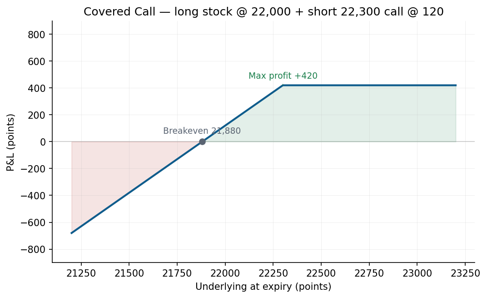
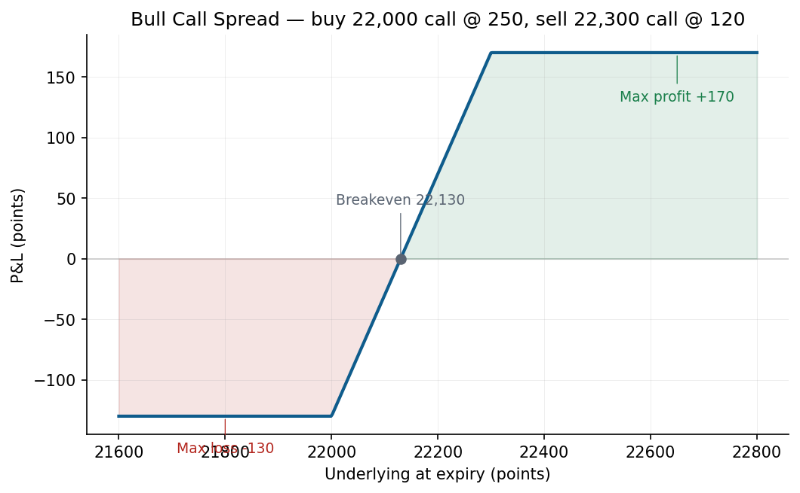
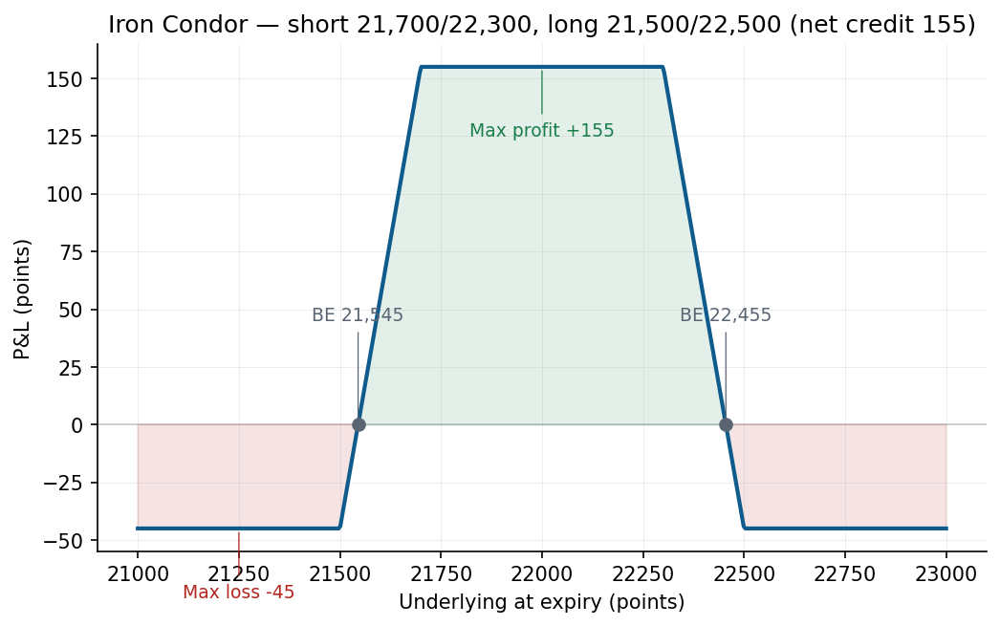
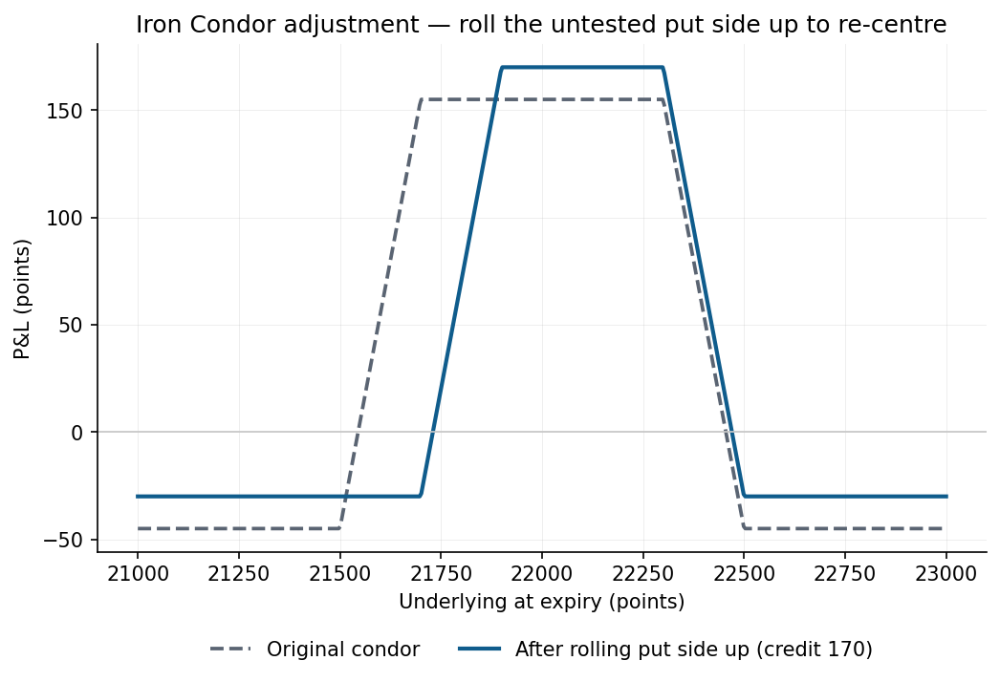
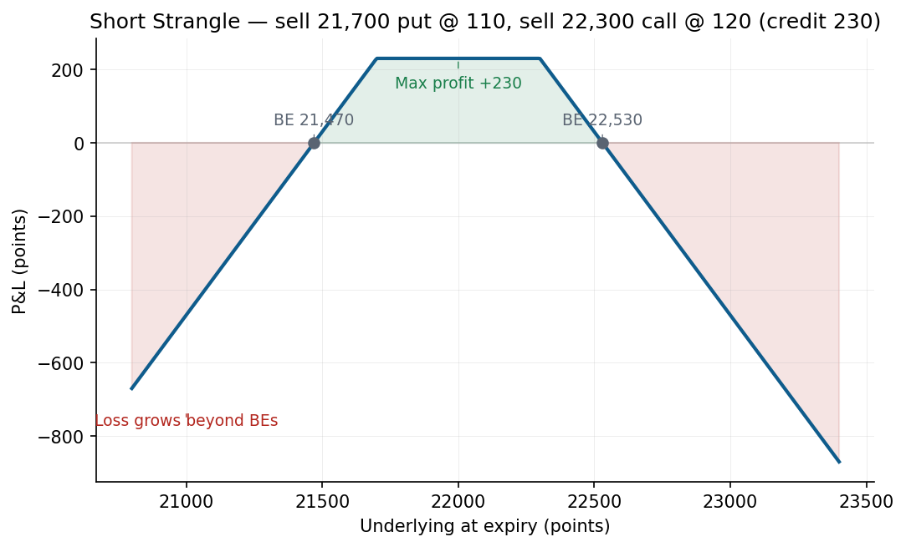
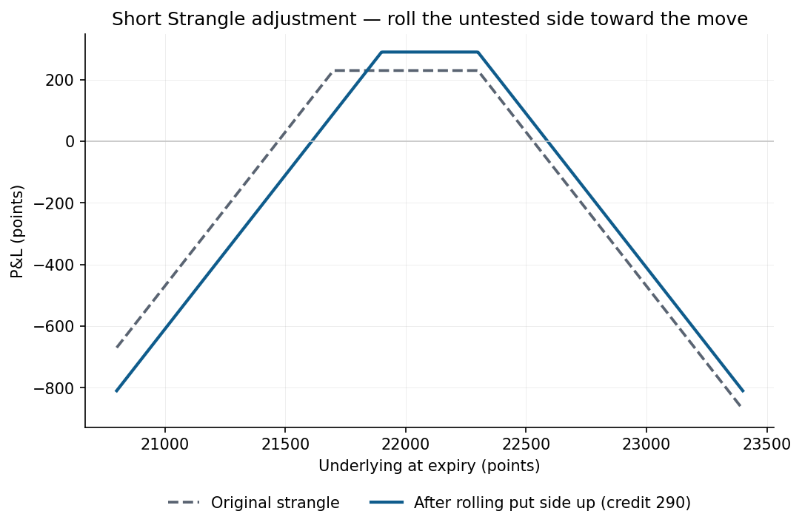
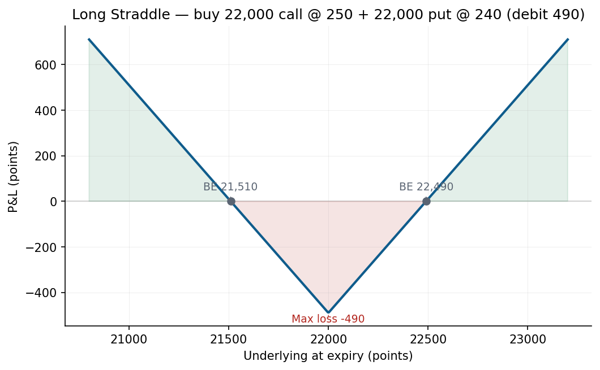

# Options Trading Adjustments

## Top 5 Option Strategies, Their Scenarios and Their Adjustments — for the NSE

---

**Published by StratLab**

---

**A practical reference with payoff diagrams. Illustrative Nifty-style strikes.**

---

> **Disclaimer.** This book is for **education only**. It is not investment advice, not a recommendation to buy or sell any security, and the author is not a SEBI-registered investment adviser. **Options — and especially short options — can lose more than the premium received, and carry high risk.** Margin requirements, lot sizes, strike intervals and expiry days change over time: always confirm the current contract specifications on the NSE website before trading. All strikes, premiums and P&L figures in this book are illustrative.

---

## Important Disclaimer

This book is provided for **educational purposes only**. It is not investment advice, a recommendation, or a solicitation to buy or sell any security.

- **StratLab is not registered with SEBI** as an investment adviser, research analyst, or portfolio manager, and does not provide investment advisory services.
- Trading involves substantial risk of loss and is not suitable for everyone. You can lose part or all of your trading capital.
- All examples, figures, and historical observations are illustrative. Historical performance never guarantees future results. Strategies described here have worked *historically* in certain conditions; that does not mean they will work in the future or in your specific situation.
- Margin, taxes (STT, stamp duty), brokerage, and other regulatory details change over time. Always verify current rules and costs before trading.
- Nothing in this book should be read as a promise of profit or a guarantee that any strategy will be profitable.

By reading this book, you agree that you are solely responsible for your own trading decisions and that you will consult a SEBI-registered adviser where appropriate.

---

## Table of Contents

1. The Option Refresher
2. The Greeks That Drive Adjustments
3. The Adjustment Mindset
4. NSE Specifics That Matter
5. Strategy 1 — The Covered Call
6. Strategy 2 — The Bull Call Spread
7. Strategy 3 — The Iron Condor
8. Strategy 4 — The Short Strangle
9. Strategy 5 — The Long Straddle
10. The Techniques
11. A Decision Framework
12. The One-Page Reference

Glossary

---

# 1. The Option Refresher

*Part I — Foundations*

An **option** is a right, but not an obligation, to buy (a **call**) or sell (a **put**) an underlying at a fixed **strike price** on or before **expiry**. On the NSE, index options (Nifty, BankNifty) are the most liquid instruments and are **cash-settled**.

## The premium

The price of an option is its **premium**, which has two parts:

- **Intrinsic value** — the amount the option is in-the-money (`spot − strike` for a call, `strike − spot` for a put). Zero for out-of-the-money options.
- **Time value** — everything else; the market's price for *time* and *uncertainty* remaining until expiry.

**The single most important fact for every strategy in this book:** time value decays to **zero at expiry**. An option at expiry is worth *exactly* its intrinsic value, nothing more. Every payoff diagram here is drawn **at expiry**, which is where all the time value has vanished.

## Buying vs selling

- **Buying an option** gives you the right; your loss is capped at the premium, your profit is theoretically large. You *pay* time decay.
- **Selling (writing) an option** obligates you; you *collect* the premium, and you *earn* time decay — but your risk can be large (or, for an uncovered option, unbounded).

Almost all "adjustments" in this book exist to manage the risk of the **sold** side, because that is where the obligations live.

# 2. The Greeks That Drive Adjustments

The Greeks describe how an option's price responds to its inputs. You do not need to compute them — you need to know what each one *means* for a position, because every adjustment in this book is a deliberate change to one of these exposures.

| Greek | Measures | What it means for you |
|---|---|---|
| **Delta** | Change in option price per 1-point move in the underlying | Directional exposure; ~+1 for a deep in-the-money call, ~−1 for a deep in-the-money put, ~±0.5 at-the-money |
| **Gamma** | Rate of change of delta | How *fast* your directional exposure changes as the market moves — highest at-the-money and near expiry |
| **Theta** | Change in price per day of time passing | Time decay; **positive** for option sellers, negative for buyers |
| **Vega** | Change in price per 1% change in implied volatility | Volatility exposure; short options are **short vega** (hurt by rising IV), long options are long vega |

**How to read a position through the Greeks:**

- A **short strangle / iron condor** is *short gamma and short vega, long theta*. It profits from time passing and calm; it loses when the market moves fast or volatility spikes. Adjustments to these strategies are usually about **managing the directional (delta) drift** after a move.
- A **long straddle** is *long gamma and long vega, short theta*. It profits from a big move or a volatility pop; it bleeds time. Its "adjustment" is usually *not* to hold it too long.
- A **covered call** is net long delta (the stock) with positive theta from the short call; it is a *reduce-upside, add-income* trade.
- A **bull call spread** is long delta with a defined risk; its adjustment is about *locking in* or *rolling up* when the view proves right.

# 3. The Adjustment Mindset

An adjustment is a **change to an existing position to alter its risk or its outlook**. It is not a separate trade; it is a deliberate repair or enhancement of the trade you already have on.

## The three questions before any adjustment

1. **Is my original view still valid?** If the reason you entered no longer holds, the answer is usually to **close**, not to adjust. Adjustments are for positions whose *reason* is intact but whose *shape* is now wrong.
2. **What risk am I actually fixing?** Name the exposure: too much delta after a move, too much gamma near expiry, a vega hole ahead of an event. Adjust the *specific* risk, not the general feeling.
3. **What would I do if I had no position?** If the answer is "this trade", hold or adjust toward it. If the answer is "nothing", close. This single test prevents most bad adjustments.

## The rules of thumb

- **Adjust early, not late.** Small, early adjustments (rolling an untested side, trimming delta) are cheap and controlled. Waiting until a short option is deep in-the-money makes every choice expensive and forced.
- **Adjust in small steps.** One step at a time, then re-read the position. Over-adjusting (adding multiple legs in panic) usually just locks in a worse position.
- **Know the cost.** Every adjustment has a debit or credit and changes your breakevens. Recompute the payoff (or re-run the diagram) after the adjustment, or you are flying blind.
- **Never let a small defined-risk position become a large undefined-risk one through "one more roll".** A strangle rolled repeatedly into a losing trend is how accounts get hurt.

## When NOT to adjust

- When the original premise is broken — **close**.
- When the position is small and the cost of adjusting exceeds the risk being fixed — **let it be or close**.
- When you cannot articulate what the adjustment does in one sentence — **do nothing**.
- When you are adjusting out of emotion (to "feel productive") rather than to fix a named risk — **do nothing**.

# 4. NSE Specifics That Matter

Before the strategies, the practical Indian context:

- **Instruments.** Nifty and BankNifty index options are the deep, liquid core. Individual stock options exist but are thinner and physically settled — check the contract before trading.
- **Expiries.** Since SEBI's November 2024 rules, each exchange may offer only **one weekly** index expiry. On the NSE that is Nifty (weekly expiry on **Tuesday** since September 2025, previously Thursday); BankNifty and the other NSE indices now have **monthly** expiries only. Weekly-expiry conventions (which day, which index) have been revised by SEBI/NSE over time — **confirm the current weekly expiry day** before trading weeklies.
- **Lot sizes.** Index option lot sizes have changed over the years (and differ between Nifty and BankNifty). **Check the current lot size** and multiply the point-based P&L diagrams here by the lot size to get rupee P&L.
- **Margins.** Buying an option costs only the premium. **Selling** an option requires margin (SPAN + exposure). Covered positions (covered call on a futures/stock position) attract lower margin than naked shorts. Margin is a first-class constraint in every short-option strategy in this book.
- **Settlement.** Index options are European and cash-settled at expiry — no early exercise, no delivery worry. Payoff at expiry is exactly what the diagrams show.

**A note on the diagrams.** All payoff diagrams are drawn **at expiry, in points** (not rupees). To convert: `rupee P&L = point P&L × lot size`. The illustrative spot is 22,000 with strikes around it; substitute your own spot and strikes in real use.

# 5. Strategy 1 — The Covered Call

*Part II — The Five Strategies*

## What it is

Hold the underlying (stock, or a long futures position) and **sell a call** against it at a strike above the current price. You collect the call premium as income; in exchange, your upside beyond the strike is given up.

**Illustrative setup (see diagram):** long Nifty-equivalent at 22,000; sell a 22,300 call @ 120 → max profit 420 (300 + 120); breakeven 21,880.

## When to use it

- You are **mildly bullish to neutral** — you want to hold the position but do not expect a large rally.
- You want to **enhance yield** on a position you are willing to hold (the premium is income).
- Volatility is **elevated**, so the call you sell carries a fat premium.

## Greeks profile

- Net **positive delta** (you are still long the market, just less so than the raw position).
- **Positive theta** (the short call decays in your favour).
- Mildly **short vega** (a volatility crush helps the short call slightly).

## Scenarios at expiry

- **Market up, beyond the strike:** you keep the premium and gain up to the strike; beyond the strike your profit is capped. This is the *cost* of the income.
- **Market up, but below the strike:** you gain the premium *plus* the stock's rise — and the closer to the strike, the better; profit peaks at the strike.
- **Market sideways:** you keep the full premium while the stock sits flat.
- **Market down:** the premium cushions the loss by the amount received; the stock loss is still real and uncapped to the downside.

## Adjustments

- **Roll the call up and out** if the market rallies hard and you now want more upside: buy back the short call and sell a higher-strike, later-expiry call (for a small credit or debit). This raises your ceiling at the cost of giving the trade more time.
- **Roll down** if the market has fallen and you want more income protection: buy back the call and sell a lower-strike call (nearer the money) — more premium, but a lower cap.
- **Close the call leg alone** if your view turns outright bullish — the stock is free to run again.
- **Exit the whole position (stock + call)** if the view turns bearish — the premium will not protect you from a real decline.

## When NOT to use it

- When you are **strongly bullish** — you are selling your own upside for a small premium.
- When you are **not willing to hold the stock through a decline** — the premium cushion is small.
- When volatility is very low and the call premium is not worth the cap you are giving up.

# 6. Strategy 2 — The Bull Call Spread

## What it is

Buy a call at a lower strike and **sell a call at a higher strike** (same expiry). You pay a **net debit** (the premium of the bought call minus the credit from the sold leg), your risk is capped at that debit, and your profit is capped at the spread width minus the debit.

**Illustrative setup:** buy 22,000 call @ 250, sell 22,300 call @ 120 → net debit 130; max profit 170; max loss 130; breakeven 22,130.

## When to use it

- You are **moderately bullish** and want a *defined-risk* alternative to buying a naked call.
- Volatility is high (a debit spread is cheaper to buy than a naked call because you sell away some vega).
- You want a fixed, known maximum loss.

## Greeks profile

- **Positive delta** (bullish), but *lower* than a naked call because the short leg offsets some delta.
- **Lower vega** than a naked call (the two legs partially cancel volatility exposure).
- **Negative theta** (debit), but decays *slower* than a naked call.

## Scenarios at expiry

- **Market up past the upper strike:** you earn the maximum profit (170) — no more, even if it keeps rising.
- **Market up but between strikes:** above the 22,130 breakeven you are in partial profit, growing toward the cap; below it, a partial loss.
- **Market sideways:** you lose time value; at or below 22,000 at expiry the whole debit is lost.
- **Market down:** you lose the net debit, but no more than that.

## Adjustments

- **Roll up** if the market has run through your upper strike and you want more participation: buy back the spread and re-establish it at higher strikes, ideally for a credit or small debit. This keeps you in a winning trend with fresh upside.
- **Convert to a butterfly** near the upper strike if you now expect a *pause*: sell an *additional* call at your short strike and buy one the same distance above it, turning the capped profile into a small sweet-spot range.
- **Close the short leg** if you turn strongly bullish — leaving just the long call (now with more upside but more cost).
- **Take profit** by closing the whole spread when the maximum profit is nearly in hand — a debit spread's remaining time value is small once fully in-the-money, and holding for the last few points is usually poor risk/reward.

## When NOT to use it

- When you are **only mildly bullish and short on time** — the spread needs the market to move, and time works against it.
- When you are **bearish** (obviously) — this is a bullish position.
- When volatility is very low and the debit is cheap relative to the expected move — consider a naked call or a different structure.

# 7. Strategy 3 — The Iron Condor

## What it is

A **neutral, defined-risk, credit** strategy: sell an out-of-the-money **put spread** below the market and an out-of-the-money **call spread** above it. You collect a **net credit** and profit if the market stays between the short strikes.

**Illustrative setup:** sell 21,700 put @ 110, buy 21,500 put @ 35; sell 22,300 call @ 120, buy 22,500 call @ 40 → net credit 155; max profit 155; max loss 45 (wing width 200 − credit 155); breakevens 21,545 and 22,455.

*The premiums are illustrative: real condors usually collect a much smaller credit relative to the wing width, so the maximum loss is typically larger than the maximum profit.*

## When to use it

- You expect the market to be **range-bound** or **low-volatility** through expiry.
- You want a **defined risk** (unlike a naked strangle) with a known maximum loss.
- You want to earn premium from **time decay and a volatility crush**.

## Greeks profile

- **Near-zero delta** at entry (balanced above and below).
- **Positive theta** (both sold spreads decay in your favour).
- **Short vega** (you profit if implied volatility falls; you lose if it spikes).
- **Short gamma** near the short strikes as expiry approaches — the position becomes increasingly sensitive to a move late in its life.

## Scenarios at expiry

- **Market closes between the short strikes:** you keep the full credit — the ideal outcome.
- **Market drifts toward one wing:** the untested side decays toward zero; the tested side is worth more. You still profit as long as price stays inside the breakevens.
- **Market breaks a breakeven:** the loss begins, capped at the maximum loss beyond the long wing.
- **Market gaps hard through a wing:** you hit maximum loss on that side (capped — that is the point of the wings).

## Adjustments

The classic adjustment is **rolling the untested side** toward the move (see the diagram — rolling the put side up after a rally):

- **Roll the untested side closer** to re-centre the condor and collect more credit: if the market rallies toward the call wing, buy back the put spread and sell a *higher-strike* put spread. This re-balances the delta and adds premium, at the cost of narrowing your profit zone.
- **Roll the tested side out** to buy time or space if the market is approaching a wing but you still think it will revert.
- **Close one side** if the trend is clearly one-way: keep the untested (now near-worthless) side's credit, and close/roll the tested side.
- **Convert to an iron fly** (both short options at the same strike) if you now expect a tight range around the current price.
- **Close the whole condor** if the premise (range-bound) breaks — taking a small loss beats hoping a broken thesis repairs itself.

## When NOT to use it

- **Before a known volatility event** (earnings, budget, policy) — a gap will blow through a wing. (Deliberately selling an event's IV crush with a small, defined-risk condor is a separate trade that knowingly accepts this gap risk — see *Event & Earnings Trading on the NSE*.)
- When **volatility is very low** — you collect little premium for a large defined risk, and a single expansion hurts.
- When you expect a **trend**, not a range — a condor is a bet *against* a big move.

# 8. Strategy 4 — The Short Strangle

## What it is

A **neutral, undefined-risk, credit** strategy: sell an out-of-the-money put *and* an out-of-the-money call, both **naked** (no wings). You collect a larger credit than an iron condor, but the loss is **uncapped** beyond the breakevens.

**Illustrative setup:** sell 21,700 put @ 110, sell 22,300 call @ 120 → net credit 230; breakevens 21,470 and 22,530.

## When to use it

- You expect a **range** and are confident the market stays inside the breakevens.
- You accept the **undefined risk** (with a stop or a margin buffer) in exchange for a fatter credit and wider profit zone than a condor.
- Volatility is **elevated** and likely to fall.

## Greeks profile

- **Near-zero delta** at entry.
- **Strong positive theta** — this is the purest "sell time" trade in the book.
- **Short vega and short gamma** — the position is genuinely exposed to a fast move; this is why it needs discipline.

## Scenarios at expiry

- **Market closes between the strikes:** full credit kept.
- **Market drifts to one side but inside the breakeven:** still a profit (smaller).
- **Market moves past a breakeven:** the loss grows linearly and is **not capped** — this is the danger.
- **Market gaps hard:** a gap can carry price far beyond a breakeven before you can react; losses can be severe.

## Adjustments

The key discipline of a strangle is **not letting the delta run away** after a move. The classic adjustment is **rolling the untested side** (see diagram):

- **Roll the untested side toward the move** to re-balance delta and collect credit: if the market rallies, buy back the short put and sell a *higher-strike* put. This centres the trade and adds premium, at the cost of a narrower profit zone.
- **Buy wings to convert to an iron condor** if you want to cap the risk after collecting early credit — this converts undefined risk into defined risk at a small cost.
- **Leg into an inverted strangle** if the market runs far: roll the *untested* side through the tested side's strike (the put strike ends up above the call strike, so the trade becomes "inverted"), which can buy time and credit — but this is advanced and increases gamma risk.
- **Stop out** on a predetermined breach (e.g., close when price crosses a breakeven by a defined amount) — the discipline that keeps an undefined-risk trade from becoming a disaster.
- **Close entirely** if volatility spikes or the range premise is broken.

## When NOT to use it

- If you are **not willing to define and honour a stop** on an undefined-risk position — do not sell a naked strangle; use an iron condor instead.
- **Before any event** that can gap the market.
- When **volatility is low** — you are collecting little for unbounded risk.

# 9. Strategy 5 — The Long Straddle

## What it is

Buy a call and a put at the **same strike** (same expiry). You pay a **net debit**, and you profit if the market makes a **large move in either direction** — you do not need to predict *which* way, only that it moves far.

**Illustrative setup:** buy 22,000 call @ 250 and 22,000 put @ 240 → net debit 490; breakevens 21,510 and 22,490.

## When to use it

- Before a **known catalyst** (earnings, budget, policy, a key data print) where the *direction* is uncertain but the *magnitude* is expected to be large.
- When **implied volatility is low** (you pay less for the options) and you expect a big move.
- When you want to **profit from a volatility expansion**, not just a price move.

## Greeks profile

- **Near-zero delta** at entry (the call and put roughly offset).
- **Long gamma** — you gain on a big move in *either* direction, increasingly as price moves away.
- **Long vega** — you profit if implied volatility rises after entry.
- **Negative theta** — the position bleeds time every day the market does not move; this is the cost.

## Scenarios at expiry

- **Big move either way (past a breakeven):** profit, and it grows with the size of the move.
- **Small move:** the loss is between 0 and the full debit (the "tent" of the diagram).
- **No move (closes at the strike):** you lose the entire debit — the maximum loss.

## Adjustments

The long straddle's "adjustment" is mostly about **timing and money management**, because the position's risk is already defined (the debit). Common moves:

- **Take profit into the move:** if the market gaps and one leg becomes deep in-the-money, consider closing part or all — a straddle near expiry loses the loser's remaining value fast.
- **Sell the losing leg and hold the winner** (rare, and only if the trend is now clear) — this converts the position into a directional trade.
- **Roll into a strangle** by selling the at-the-money call and put and buying further out-of-the-money ones, taking cash out of the trade (a "straddle-to-strangle" that cheapens the position, at the cost of needing an even bigger move).
- **Close before expiry** if the expected move does not materialise — do not ride a long-vega, short-theta position into a quiet expiry hoping for a late break.
- **Do not double down** by buying more premium as the position decays — that is chasing, not adjusting.

## When NOT to use it

- When **implied volatility is already high** — you are paying a rich premium for a move that may already be priced in (this is the "IV crush" problem covered in *Event & Earnings Trading on the NSE*).
- When there is **no catalyst** — a straddle without a reason is just paying theta for nothing.
- When you are not prepared to lose the full debit — the max loss happens *precisely* when nothing happens.

# 10. The Techniques

*Part III — The Adjustment Toolkit*

Every adjustment in this book is one of a small set of techniques. Learn the techniques and you can apply them to any position.

| Technique | What it does | Typical use |
|---|---|---|
| **Roll (same side, new strike/expiry)** | Close a leg, open a new one further away or later | Re-centre, add credit, buy time |
| **Roll up / down** | Move a sold strike higher / lower | Chase a trend, capture more premium |
| **Leg in / out** | Add or remove a single leg | Reduce cost, define or un-define risk |
| **Convert** | Change the structure (strangle→condor, spread→butterfly) | Cap risk, narrow a range view |
| **Hedge** | Add an offsetting position (futures, an opposite leg) | Neutralise runaway delta |
| **Close** | Exit part or all of the position | When the premise breaks |

## How to choose

- **Risk is getting too big** → reduce it (buy a wing, hedge, or close).
- **Delta has drifted one-way** → re-balance (roll the untested side).
- **Time is running out** → roll out (if the view still holds) or close (if it does not).
- **Volatility regime changed** → reassess the whole position (a short-vega trade in a rising-IV market is a different animal).

# 11. A Decision Framework

For any position that has moved against you, run this checklist **before** acting:

1. **Is the original premise intact?** No → close. Yes → continue.
2. **Which exposure is now wrong?** Name it (delta, gamma, vega, theta).
3. **What is the smallest change that fixes that exposure?** Pick the technique.
4. **What is the new payoff after the adjustment?** Recompute or re-plot it. If you cannot state the new breakevens and max profit/loss, do not make the change.
5. **Would I enter the *adjusted* position today if I had nothing on?** Yes → adjust. No → close.

**The golden rule that ties it together:** an adjustment should make you *want* to be in the new position, not merely *tolerate* it. If the adjusted position is not one you would happily enter fresh, you are just clinging to a losing idea — close instead.

# 12. The One-Page Reference

**The five strategies at a glance:**

| Strategy | View | Risk | Earns | Bleeds | Primary adjustment |
|---|---|---|---|---|---|
| Covered Call | Mildly bullish | Downside uncapped | Time decay, income | Upside (capped) | Roll the call up/down |
| Bull Call Spread | Moderately bullish | Defined (debit) | A rising market | Time | Roll up on a run |
| Iron Condor | Neutral / range | Defined (wing − credit) | Time + IV crush | A big move | Roll the untested side |
| Short Strangle | Neutral / range | **Undefined** | Time (strong) | A fast move / IV spike | Roll untested side, or add wings |
| Long Straddle | Big move, either way | Defined (debit) | A big move / IV up | Time (strong) | Take profit into the move |

**The rules:**

- Define your risk *before* entry; honour stops on undefined-risk trades.
- Adjust early and in small steps; one leg at a time.
- Recompute the payoff after every adjustment.
- Adjust to fix a *named* risk, never out of emotion.
- If the premise breaks, close — do not "one more roll" a losing undefined-risk trade.
- Convert point-based P&L to rupees: multiply by the current NSE lot size (which changes — verify).

# Glossary

**At-the-money (ATM)** — a strike equal to the underlying's current price.

**Breakeven** — the underlying price(s) at which a position neither profits nor loses at expiry.

**Cash-settled** — settled in cash at expiry rather than by delivery (index options).

**Credit / debit** — a position entered for a net premium received (credit) or paid (debit).

**Defined risk** — a position whose maximum loss is known in advance.

**Expiry** — the date the option's rights lapse and settlement occurs.

**In-the-money (ITM) / out-of-the-money (OTM)** — an option with / without intrinsic value.

**Iron condor** — a short put spread plus a short call spread (neutral, defined-risk credit).

**Iron fly** — a short straddle with long wings (a tighter, centred condor).

**Leg** — a single option within a multi-option position.

**Premium** — the price of an option (intrinsic + time value).

**Roll** — close a leg and open a new one at a different strike or expiry.

**Straddle** — a put and a call at the same strike.

**Strangle** — a put and a call at different (both OTM) strikes.

**Strike** — the fixed price at which an option can be exercised.

**Undefined risk** — a position (e.g., a naked short) whose loss is not capped.

**Wing** — the long (protective) option in a spread that defines the risk.
