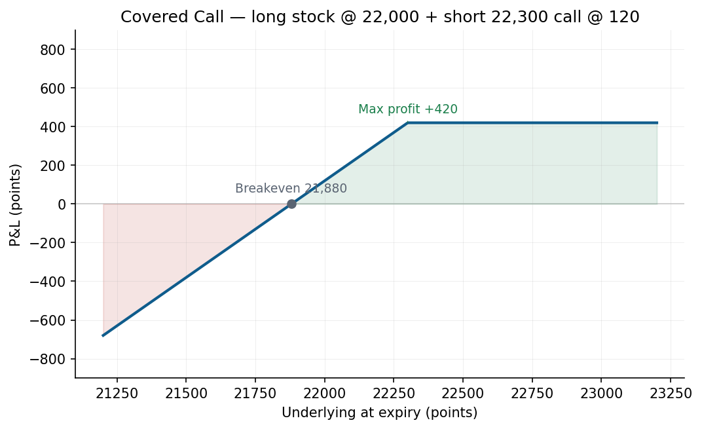

# 5. Strategy 1 — The Covered Call

*Part II — The Five Strategies*

## What it is

Hold the underlying (stock, or a long futures position) and **sell a call** against it at a strike above the current price. You collect the call premium as income; in exchange, your upside beyond the strike is given up.

**Illustrative setup (see diagram):** long Nifty-equivalent at 22,000; sell a 22,300 call @ 120 → max profit 420 (300 + 120); breakeven 21,880.

## When to use it

- You are **mildly bullish to neutral** — you want to hold the position but do not expect a large rally.
- You want to **enhance yield** on a position you are willing to hold (the premium is income).
- Volatility is **elevated**, so the call you sell carries a fat premium.

## Greeks profile

- Net **positive delta** (you are still long the market, just less so than the raw position).
- **Positive theta** (the short call decays in your favour).
- Mildly **short vega** (a volatility crush helps the short call slightly).

## Scenarios at expiry

- **Market up, beyond the strike:** you keep the premium and gain up to the strike; beyond the strike your profit is capped. This is the *cost* of the income.
- **Market up, but below the strike:** you gain the premium *plus* the stock's rise — and the closer to the strike, the better; profit peaks at the strike.
- **Market sideways:** you keep the full premium while the stock sits flat.
- **Market down:** the premium cushions the loss by the amount received; the stock loss is still real and uncapped to the downside.

## Adjustments

- **Roll the call up and out** if the market rallies hard and you now want more upside: buy back the short call and sell a higher-strike, later-expiry call (for a small credit or debit). This raises your ceiling at the cost of giving the trade more time.
- **Roll down** if the market has fallen and you want more income protection: buy back the call and sell a lower-strike call (nearer the money) — more premium, but a lower cap.
- **Close the call leg alone** if your view turns outright bullish — the stock is free to run again.
- **Exit the whole position (stock + call)** if the view turns bearish — the premium will not protect you from a real decline.

## When NOT to use it

- When you are **strongly bullish** — you are selling your own upside for a small premium.
- When you are **not willing to hold the stock through a decline** — the premium cushion is small.
- When volatility is very low and the call premium is not worth the cap you are giving up.
