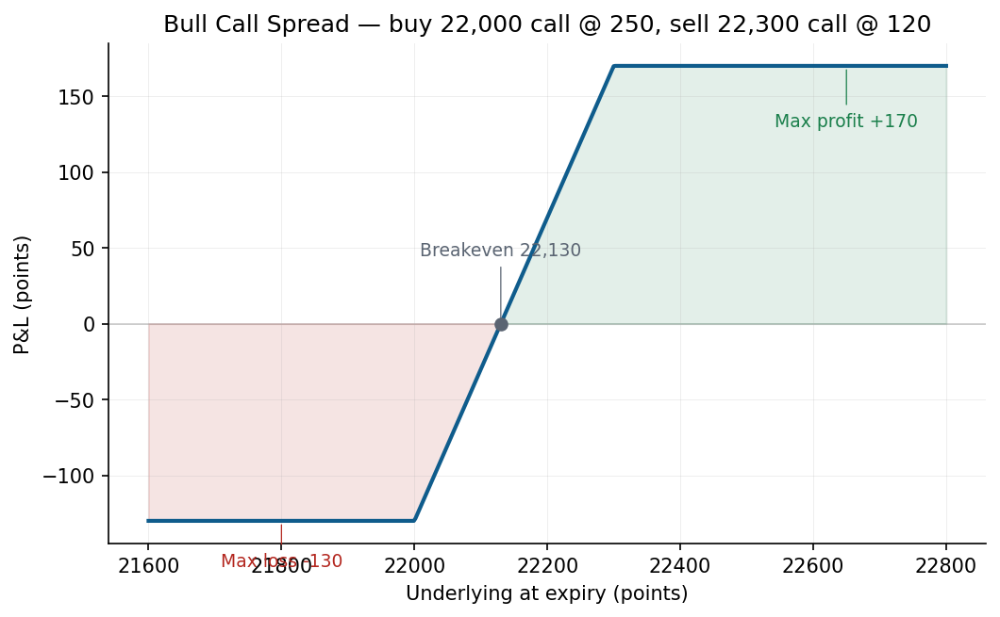

# 6. Strategy 2 — The Bull Call Spread

## What it is

Buy a call at a lower strike and **sell a call at a higher strike** (same expiry). You pay a **net debit** (the premium of the bought call minus the credit from the sold leg), your risk is capped at that debit, and your profit is capped at the spread width minus the debit.

**Illustrative setup:** buy 22,000 call @ 250, sell 22,300 call @ 120 → net debit 130; max profit 170; max loss 130; breakeven 22,130.

## When to use it

- You are **moderately bullish** and want a *defined-risk* alternative to buying a naked call.
- Volatility is high (a debit spread is cheaper to buy than a naked call because you sell away some vega).
- You want a fixed, known maximum loss.

## Greeks profile

- **Positive delta** (bullish), but *lower* than a naked call because the short leg offsets some delta.
- **Lower vega** than a naked call (the two legs partially cancel volatility exposure).
- **Negative theta** (debit), but decays *slower* than a naked call.

## Scenarios at expiry

- **Market up past the upper strike:** you earn the maximum profit (170) — no more, even if it keeps rising.
- **Market up but between strikes:** above the 22,130 breakeven you are in partial profit, growing toward the cap; below it, a partial loss.
- **Market sideways:** you lose time value; at or below 22,000 at expiry the whole debit is lost.
- **Market down:** you lose the net debit, but no more than that.

## Adjustments

- **Roll up** if the market has run through your upper strike and you want more participation: buy back the spread and re-establish it at higher strikes, ideally for a credit or small debit. This keeps you in a winning trend with fresh upside.
- **Convert to a butterfly** near the upper strike if you now expect a *pause*: sell an *additional* call at your short strike and buy one the same distance above it, turning the capped profile into a small sweet-spot range.
- **Close the short leg** if you turn strongly bullish — leaving just the long call (now with more upside but more cost).
- **Take profit** by closing the whole spread when the maximum profit is nearly in hand — a debit spread's remaining time value is small once fully in-the-money, and holding for the last few points is usually poor risk/reward.

## When NOT to use it

- When you are **only mildly bullish and short on time** — the spread needs the market to move, and time works against it.
- When you are **bearish** (obviously) — this is a bullish position.
- When volatility is very low and the debit is cheap relative to the expected move — consider a naked call or a different structure.
