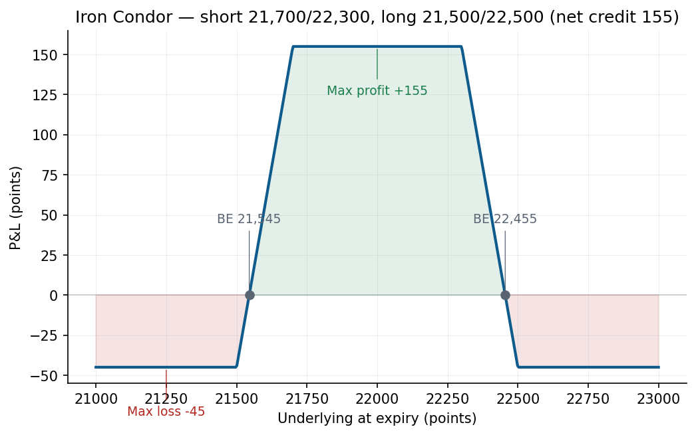
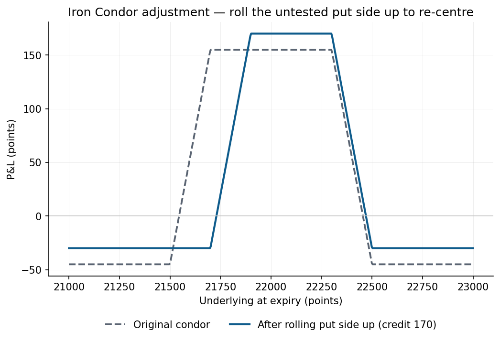

# 7. Strategy 3 — The Iron Condor

## What it is

A **neutral, defined-risk, credit** strategy: sell an out-of-the-money **put spread** below the market and an out-of-the-money **call spread** above it. You collect a **net credit** and profit if the market stays between the short strikes.

**Illustrative setup:** sell 21,700 put @ 110, buy 21,500 put @ 35; sell 22,300 call @ 120, buy 22,500 call @ 40 → net credit 155; max profit 155; max loss 45 (wing width 200 − credit 155); breakevens 21,545 and 22,455.

*The premiums are illustrative: real condors usually collect a much smaller credit relative to the wing width, so the maximum loss is typically larger than the maximum profit.*

## When to use it

- You expect the market to be **range-bound** or **low-volatility** through expiry.
- You want a **defined risk** (unlike a naked strangle) with a known maximum loss.
- You want to earn premium from **time decay and a volatility crush**.

## Greeks profile

- **Near-zero delta** at entry (balanced above and below).
- **Positive theta** (both sold spreads decay in your favour).
- **Short vega** (you profit if implied volatility falls; you lose if it spikes).
- **Short gamma** near the short strikes as expiry approaches — the position becomes increasingly sensitive to a move late in its life.

## Scenarios at expiry

- **Market closes between the short strikes:** you keep the full credit — the ideal outcome.
- **Market drifts toward one wing:** the untested side decays toward zero; the tested side is worth more. You still profit as long as price stays inside the breakevens.
- **Market breaks a breakeven:** the loss begins, capped at the maximum loss beyond the long wing.
- **Market gaps hard through a wing:** you hit maximum loss on that side (capped — that is the point of the wings).

## Adjustments

The classic adjustment is **rolling the untested side** toward the move (see the diagram — rolling the put side up after a rally):

- **Roll the untested side closer** to re-centre the condor and collect more credit: if the market rallies toward the call wing, buy back the put spread and sell a *higher-strike* put spread. This re-balances the delta and adds premium, at the cost of narrowing your profit zone.
- **Roll the tested side out** to buy time or space if the market is approaching a wing but you still think it will revert.
- **Close one side** if the trend is clearly one-way: keep the untested (now near-worthless) side's credit, and close/roll the tested side.
- **Convert to an iron fly** (both short options at the same strike) if you now expect a tight range around the current price.
- **Close the whole condor** if the premise (range-bound) breaks — taking a small loss beats hoping a broken thesis repairs itself.

## When NOT to use it

- **Before a known volatility event** (earnings, budget, policy) — a gap will blow through a wing. (Deliberately selling an event's IV crush with a small, defined-risk condor is a separate trade that knowingly accepts this gap risk — see *Event & Earnings Trading on the NSE*.)
- When **volatility is very low** — you collect little premium for a large defined risk, and a single expansion hurts.
- When you expect a **trend**, not a range — a condor is a bet *against* a big move.
