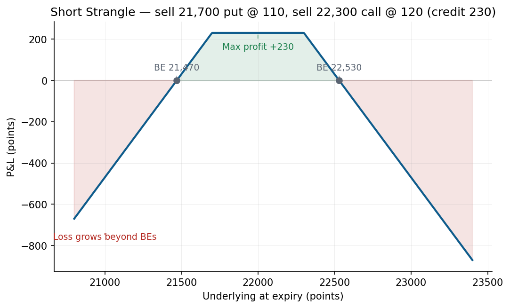
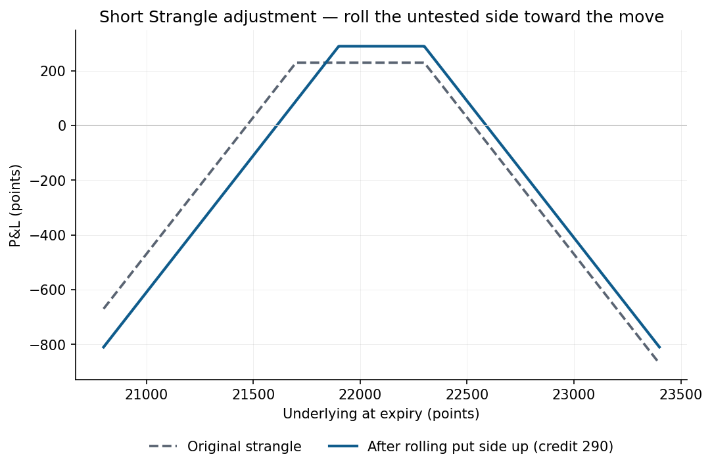

# 8. Strategy 4 — The Short Strangle

## What it is

A **neutral, undefined-risk, credit** strategy: sell an out-of-the-money put *and* an out-of-the-money call, both **naked** (no wings). You collect a larger credit than an iron condor, but the loss is **uncapped** beyond the breakevens.

**Illustrative setup:** sell 21,700 put @ 110, sell 22,300 call @ 120 → net credit 230; breakevens 21,470 and 22,530.

## When to use it

- You expect a **range** and are confident the market stays inside the breakevens.
- You accept the **undefined risk** (with a stop or a margin buffer) in exchange for a fatter credit and wider profit zone than a condor.
- Volatility is **elevated** and likely to fall.

## Greeks profile

- **Near-zero delta** at entry.
- **Strong positive theta** — this is the purest "sell time" trade in the book.
- **Short vega and short gamma** — the position is genuinely exposed to a fast move; this is why it needs discipline.

## Scenarios at expiry

- **Market closes between the strikes:** full credit kept.
- **Market drifts to one side but inside the breakeven:** still a profit (smaller).
- **Market moves past a breakeven:** the loss grows linearly and is **not capped** — this is the danger.
- **Market gaps hard:** a gap can carry price far beyond a breakeven before you can react; losses can be severe.

## Adjustments

The key discipline of a strangle is **not letting the delta run away** after a move. The classic adjustment is **rolling the untested side** (see diagram):

- **Roll the untested side toward the move** to re-balance delta and collect credit: if the market rallies, buy back the short put and sell a *higher-strike* put. This centres the trade and adds premium, at the cost of a narrower profit zone.
- **Buy wings to convert to an iron condor** if you want to cap the risk after collecting early credit — this converts undefined risk into defined risk at a small cost.
- **Leg into an inverted strangle** if the market runs far: roll the *untested* side through the tested side's strike (the put strike ends up above the call strike, so the trade becomes "inverted"), which can buy time and credit — but this is advanced and increases gamma risk.
- **Stop out** on a predetermined breach (e.g., close when price crosses a breakeven by a defined amount) — the discipline that keeps an undefined-risk trade from becoming a disaster.
- **Close entirely** if volatility spikes or the range premise is broken.

## When NOT to use it

- If you are **not willing to define and honour a stop** on an undefined-risk position — do not sell a naked strangle; use an iron condor instead.
- **Before any event** that can gap the market.
- When **volatility is low** — you are collecting little for unbounded risk.
