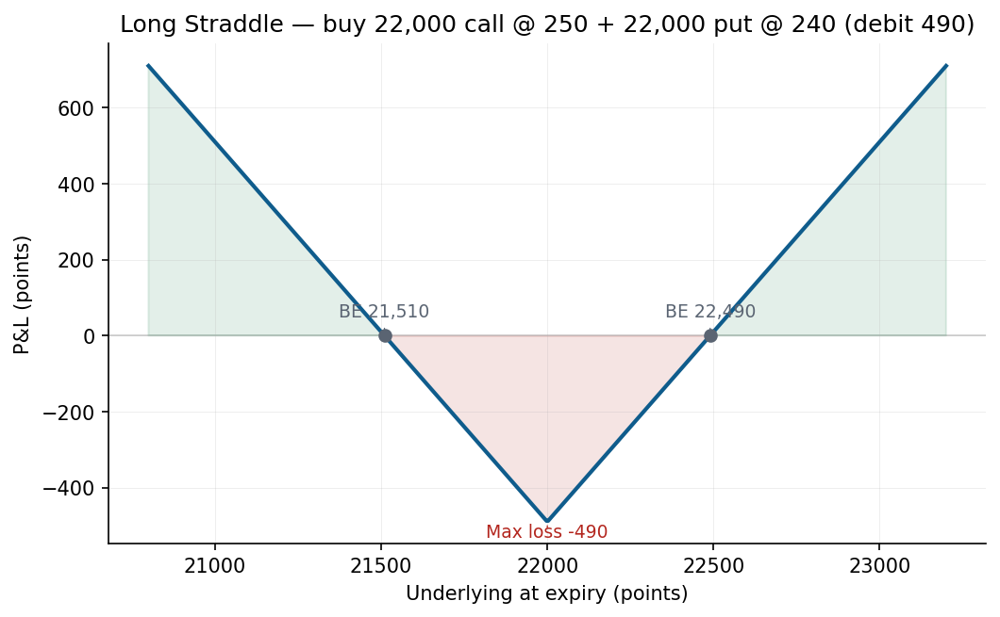

# 9. Strategy 5 — The Long Straddle

## What it is

Buy a call and a put at the **same strike** (same expiry). You pay a **net debit**, and you profit if the market makes a **large move in either direction** — you do not need to predict *which* way, only that it moves far.

**Illustrative setup:** buy 22,000 call @ 250 and 22,000 put @ 240 → net debit 490; breakevens 21,510 and 22,490.

## When to use it

- Before a **known catalyst** (earnings, budget, policy, a key data print) where the *direction* is uncertain but the *magnitude* is expected to be large.
- When **implied volatility is low** (you pay less for the options) and you expect a big move.
- When you want to **profit from a volatility expansion**, not just a price move.

## Greeks profile

- **Near-zero delta** at entry (the call and put roughly offset).
- **Long gamma** — you gain on a big move in *either* direction, increasingly as price moves away.
- **Long vega** — you profit if implied volatility rises after entry.
- **Negative theta** — the position bleeds time every day the market does not move; this is the cost.

## Scenarios at expiry

- **Big move either way (past a breakeven):** profit, and it grows with the size of the move.
- **Small move:** the loss is between 0 and the full debit (the "tent" of the diagram).
- **No move (closes at the strike):** you lose the entire debit — the maximum loss.

## Adjustments

The long straddle's "adjustment" is mostly about **timing and money management**, because the position's risk is already defined (the debit). Common moves:

- **Take profit into the move:** if the market gaps and one leg becomes deep in-the-money, consider closing part or all — a straddle near expiry loses the loser's remaining value fast.
- **Sell the losing leg and hold the winner** (rare, and only if the trend is now clear) — this converts the position into a directional trade.
- **Roll into a strangle** by selling the at-the-money call and put and buying further out-of-the-money ones, taking cash out of the trade (a "straddle-to-strangle" that cheapens the position, at the cost of needing an even bigger move).
- **Close before expiry** if the expected move does not materialise — do not ride a long-vega, short-theta position into a quiet expiry hoping for a late break.
- **Do not double down** by buying more premium as the position decays — that is chasing, not adjusting.

## When NOT to use it

- When **implied volatility is already high** — you are paying a rich premium for a move that may already be priced in (this is the "IV crush" problem covered in *Event & Earnings Trading on the NSE*).
- When there is **no catalyst** — a straddle without a reason is just paying theta for nothing.
- When you are not prepared to lose the full debit — the max loss happens *precisely* when nothing happens.
